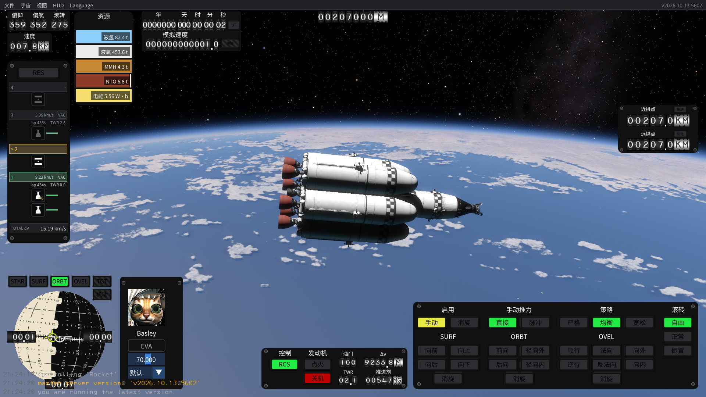

# KSA Chinese：5602 简体中文汉化预览

为 Kitten Space Agency 提供独立代码 Mod、审核词典、中文字体和安装/卸载脚本。适配精确版本 `2026.10.13.5602` 与记录的依赖哈希。

[下载 v0.1.2 便携 Mod](https://github.com/kuxiaowo/KSA-CHINESE/releases/tag/v0.1.2)。完整解压到游戏目录，运行 `KsaChinese/KsaChineseLauncher.exe`。文件位于 `Content/KsaChinese`，随包加载器自动配置；说明见 [便携 Mod](README-便携Mod.md)。原 `KSA.exe` 本身不执行代码汉化。旧版独立安装包仍保留在 v0.1.0 Release。

先阅读 [安装卸载](README-安装卸载.md)、[制作与验证](reports/制作与验证-5602.md)、[逐条底稿](translations/reviewed-5602.jsonl) 和 [第三方许可](THIRD_PARTY.md)。这是部分汉化预览，详细图形/存档与未覆盖限制以报告为准。

运行需要 .NET 10 x64 Runtime。便携包新增自己的目录，不替换游戏文件。默认使用 `KsaChinese/Profile`，可指定已有汉化档案。未知版本/哈希拒绝启动；缺译文回退英文。

开发：安装 .NET 10 SDK，准备合法的本地 KSA 安装与 StarMap 0.4.7，运行 `.\scripts\build.ps1 -GameDir 'C:\Games\Kitten Space Agency' -LoaderDir 'C:\Tools\StarMap-0.4.7' -Validate`。Python 工具优先在 conda 环境中执行，字体重建需要 `fontTools` 和被忽略的固定 Noto 源文件。`scripts/build_translations.py`从逐条审核记录生成JSON与resx，`scripts/build_font.py`检查字形，`scripts/package.py`按白名单打包。源文定位所依赖的反编译材料和调查候选仅存于本机，不随包。

启用1660条语义审核词条；131项无图形检查通过，并抽查中文HUD、设置、规划及中英切换。v0.1.2 补齐仪表右键菜单，并将启动星际预设名称改为“太阳系及邻近恒星”和“太阳系及邻近恒星（扩充版）”。v0.1.1 的分级显示、字体去重与存档回退验证记录保留。编辑器/部件窗口缺视觉证据，全部按钮与长期稳定性尚未全面验证。

阅读 [可行性评估](reports/汉化可行性评估-2026-10-13.md) 和 [本机统计](reports/local-audit-2026-10-13.json)。本次调查针对 KSA **2026.10.13.5602**。

`scripts/audit_localization.py` 只读取指定的 KSA、KSP 与玩家目录，输出统计和待审核候选清单。候选清单、反编译材料及第三方调查工具仅保存在被 Git 忽略的 `work/`、`.tools/`，不能当作汉化完成率或可分发游戏源码。

分支流程：`developing → PR → main`。代码和译文遵循 MIT，字体遵循 OFL；复用来源与署名见 `THIRD_PARTY.md`。公开调查/验证记录中的个人本机路径已脱敏；记录保留原始游戏与资源哈希。
