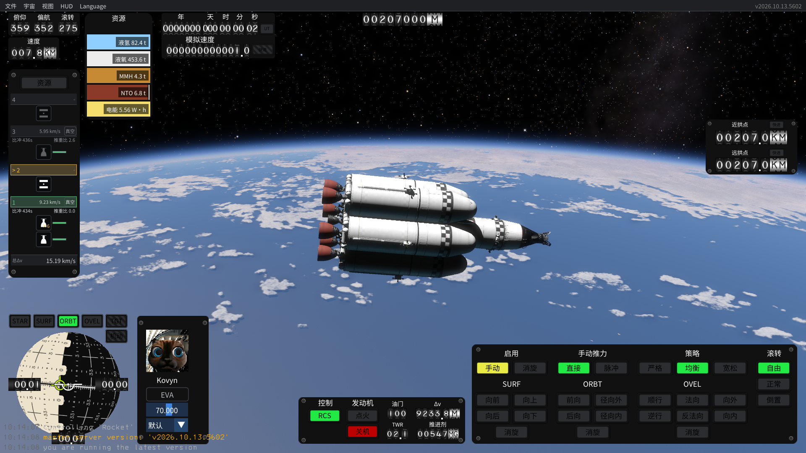

# 0.1.1：便携 Mod 与截图漏译修复

针对 KSA `2026.10.13.5602`。新增游戏目录布局：汉化置于 `Content/KsaChinese`，自有启动程序与随包 StarMap 位于 `KsaChinese`。自动配置游戏路径，失败时显示错误并写日志。原游戏 EXE/DLL 和 Core/Gauges.xml 的四项受保护指纹保持不变。

补齐当前配置文件的系统显示名 `Interstellar (Dense)` / `Earth and Moon`，以及 LocationObject.GetName 中的 `Luna`。启动下拉框保存原系统键、地点键和控件 ID；Apollo11 等任务型号与玩家地点名称保留。

分级面板补齐资源按钮、真空/大气计算工况、比冲、推重比和总速度增量，仅在两个 SequenceList 绘制方法内替换显示片段。Isp 的 F0、TWR 的 F1、速度增量的 DistanceReference 格式与单位、所有原计算及隐藏控件 ID 保留。中文比冲改为左对齐，避免默认窄面板与右侧推重比重叠；英文位置仍使用原算法。

实测新布局首次启动暴露了字体重名：游戏自动扫描 Content 内相对路径字体，而旧注册逻辑只排除绝对路径。修复为按图集使用的字体名称去重，其他字体保持。该问题发生在布局调整后的本次独立测试中，不能据此认定它就是用户此前旧快捷方式打不开的原因。旧入口当时已重试成功，原故障未稳定复现。

验证结果：

- 116 项无图形检查通过，237 个补丁目标引用已解析。新增断言覆盖当前系统显示名、中英文控件哈希、月球地点显示、玩家名称保留、分级数值/单位、字体重复路径处理。
- 字体重建包含 1327 个字形映射，审核包所需字符缺失为零。词典启用 1655 条；数量不代表全游戏覆盖率。
- 在 `<WORKSPACE>/work/test-profile` 运行新的 EXE 入口，中文 HUD、图形/控制设置、英文 HUD、切回中文共五次截图，自动正常退出。最终运行日志无 ERROR/Exception，具有 quick-completed 标记。
- 1920×1080 截图目视确认 RES→资源、VAC→真空、Isp→比冲、TWR→推重比、TOTAL dV→总Δv，显示数值仍为 436s / 2.6 / 15.19 km/s 等原值，比冲与推重比不再重叠。英文回退及再次切回中文已截图检查。
- 启动下拉内容通过实际游戏方法补丁解析和字典/ID 检查，尚未取得新版下拉框展开截图。ATM 与工况切换点击未作本次视觉/操作测试。编辑器、其他分辨率和长时间运行仍待进一步验证。
- 新启动器对真实四项指纹检查退出码 0；空目录和伪造 KSA.dll 测试分别退出码 1，并留下中文错误记录。正常错误弹窗在本次字体失败时实际出现。
- 本机桌面统一为一个入口，调用新 EXE 后游戏窗口实际可见并响应。继续使用原汉化 Profile，旧 Mod 和快捷方式已备份；测试没有读取个人存档内容。
- 便携 ZIP 32 个文件，含逐文件 SHA256 清单；只包含自有 Mod/启动器、StarMap/Harmony、字体及许可，不含游戏 DLL、Core 原资源、调查源码或档案。ZIP 完整性检查通过。

代码 Mod 仍需 StarMap，直接启动原 KSA.exe 不会执行汉化。默认便携档案放在 KsaChinese/Profile，可指定已有汉化档案。游戏更新后精确指纹不符时拒绝加载；额外目录是否被更新器保留没有作真实游戏更新实验。文件保留和兼容性是两个问题，不能承诺自动适配更新后的游戏。
