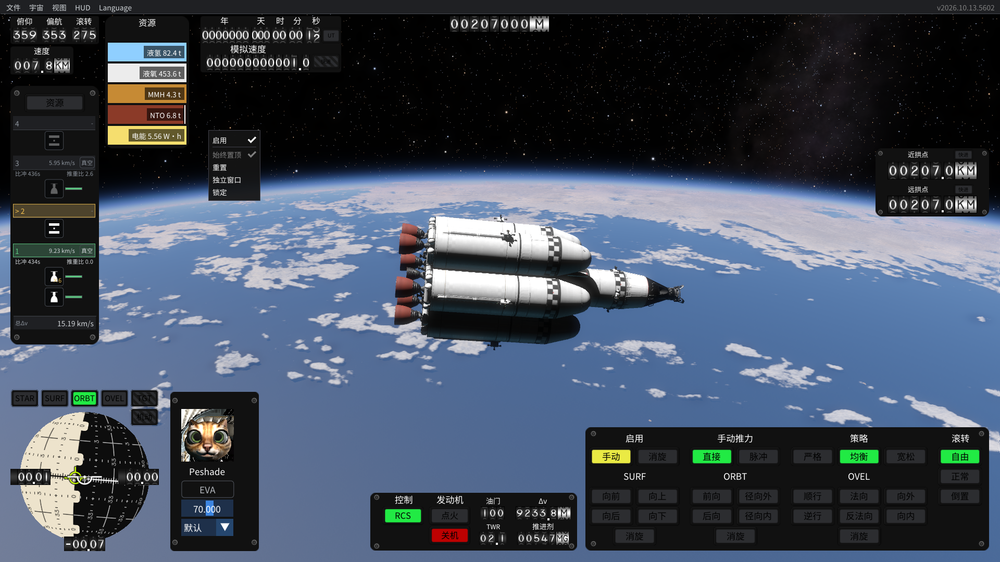
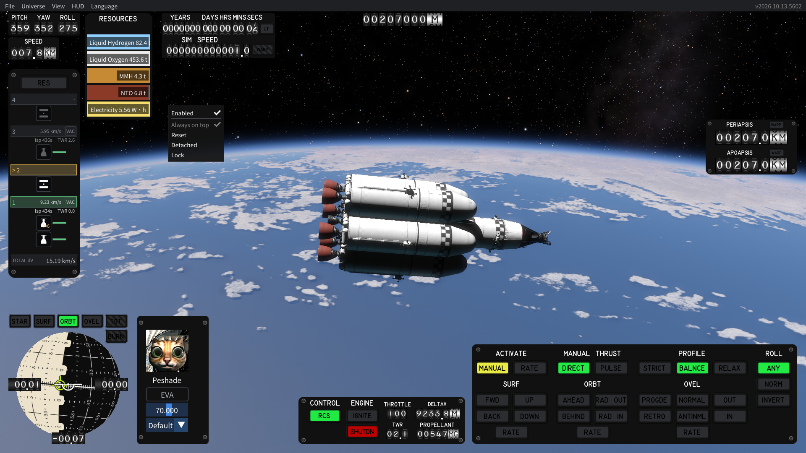

# 0.1.2：仪表右键菜单补译

截图中的 Enabled、Always on top、Reset、Detached、Lock 来自 GaugeCanvas.OnDrawUi 的独立右键菜单。现有 ImGuiWindow.DrawViewMenu 补丁不覆盖这条路径；Always on top 也不同于旧词条的 Always on Top。

只在该仪表绘制方法内包装 ImGuiHelper.DrawMenuItem 的按值/按引用两个重载，显示为“启用、始终置顶、重置、独立窗口、锁定”。原 bool 状态、disabled 参数、返回值、按 Alt 时的弹窗行为、复选勾选绘制仍使用原游戏 helper，未重写相关控制逻辑。调试字段、玩家名称和弹窗 ID 不改写。

活动项目使用在两种语言下相同的隐藏 ID。禁用项目由 TextDisabled 绘制，不能传入 ### 隐藏标记，否则标记会作为文字显示。原 helper 附加的三个空格在隐藏 ID 后不再提供显示留白，因此另在可见标签末尾增加留白，避免文字与勾选符号重叠。

验证：131 项无图形检查通过，238 个目标引用；该方法中 7 个按值和 2 个按引用调用均匹配并成功安装。包含中英 ID 哈希与 helper 尾部空格的组合、禁用项隐藏标记不泄露、英文回退、未知名字/调试字段保护的检查。

在独立 `<WORKSPACE>/work/test-profile` 中，开发专用 SmokeDriver 打开真正的 SequenceCanvas 右键弹窗，不注入鼠标点击，也不改动勾选状态。最终中文→英文→中文三次截图均实际保存并目视核对，灰色置顶项、勾选符号、五项译文和留白正常；日志有 gauge-context-completed，未发现 ERROR/Exception，测试正常退出。测试驱动不会放入玩家包。1920×1080 以外的排版与实际点击锁定/独立窗口等操作未在本次测试覆盖。

首次字形检查发现旧子集缺少“锁”，重建后映射 1329 个字形，审核包所需字形缺失为零。词典启用 1660 条，数字不代表全游戏覆盖率。

本机 Mod 代码、字体和词典均已更新并备份旧文件。通过替换文件安装，不关闭当前游戏进程；当前运行仍使用已加载的旧代码，需要重新启动以加载修复。原游戏 DLL、配置/存档和桌面入口没有因这次修复被替换。

此包也纳入上一轮的“太阳系及邻近恒星”和“太阳系及邻近恒星（扩充版）”名称修订。仍只支持已检查的 5602 精确指纹，其他限制见之前的验证报告。

