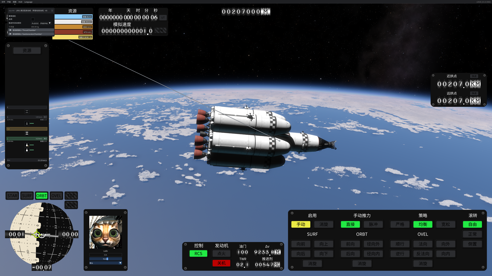

# 0.1.3 部件名称补译：5602 本地预览

本次按“型号、代号保留，进一步翻译其余部件描述”的要求补译。开发位于 `developing`，没有提交、推送、发布或安装到个人游戏目录。

## 覆盖范围与语义复核

本机原版 `2026.10.13.5602` 与现有兼容清单的四项文件哈希一致。只读取 Core XML、模板数据和相关显示代码；没有修改游戏 DLL、Core XML、物理值、资源键、控制器型号、存档或玩家命名。

Core 中有 180 个顶层 `Part` 定义，旧专用部件词典覆盖其中 51 个。本次补齐为 179 个中文类型名称，加上纯型号 `VTR-10` 的原样保留决策；另补 `Drogue` / `Main Parachutes` 两个有独立显示名的子部件，专用部件词典共 182 条。180 包含隐藏/测试资源，不能说是 180 个编辑器可选部件。

新增 130 条逐项记录，并解除已有 `EngineA2` 的 `needs-context`：实际运行按 `PartTemplate.Id` 查词典，能够覆盖 `LR91 Sea` 显示名。新增记录见 `translations/review-parts-expansion.jsonl`，原记录修订见 `review-editor-resources.jsonl`。每项带原始显示名或回退 ID、类别、模块、源文件定位、译文、型号/规格保留说明与复核者；均为本次主智能体语义复核，没有冒称真人或独立复审。

| 原显示/资源含义 | 中文显示举例 |
| --- | --- |
| LR91 Sea | LR91 海平面型发动机 A2 |
| LR91 Vac + Verniers | LR91 真空型发动机（带游动发动机）A5 |
| MRS-1 Magnetic Scoop | MRS-1 磁场收集器 |
| MTT-1 Magnetic Trap Tank | MTT-1 磁阱储箱 |
| RAIR-1 Antimatter Ramjet | RAIR-1 反物质冲压发动机 |
| FPD-1 Torch | FPD-1 聚变火炬发动机 |
| Fuel Port | 推进剂接口 |
| SRB Size D Thrust Assembly | D 型固体助推器推力组件 A |
| Drogue Radial A | 径向安装减速伞 A |
| VTR-10 | VTR-10 |

区分了实际带 `Tank` 的变径段/头锥与结构件；`SolarPanelB` 的发电模块在子部件上；小型燃料电池的当前定义只有质量数据，译名不宣称已经实现发电功能。保留 A/B 等变体、`1WHalfHA` 等规格编码，不根据内部编码臆测尺寸或性能。

## 显示入口与验证

原有编辑器部件提示、属性窗口和资源界面继续使用模板键查词典。本次新增飞行 `Part.OnDrawUi` 的显示接入：第一个名称读取用于原始窗口 ID，原样保留；第二个读取替换可见标题；第三个用于右键菜单标题，采用固定规范 ID，在中文和英文之间保持相同。玩家自定义名称，包括刚好与词典文本同名的自定义名称，保留原值。模板字段与部件实例没有被重命名。

- Release 构建零错误、零警告；503 项无图形检查、239 个补丁目标签名引用通过。包含 180 个实际 XML 模板的名称/纯型号决策、模板字段不变、玩家名称保护、语言往返和原生 ImGui 哈希检查。239 不是窗口数量。
- `scripts/audit_parts.py` 对当前 Core 定义重新清点并记录 XML 哈希，顶层部件缺项为零；结果见 `parts-5602-audit.json`。
- Noto 字体子集重新生成，最终词典所需字符无缺失；见 `font-validation.json`。
- 真实独立实例加载了本次精确 DLL、词典和字体。游戏注册表有 650 个主/子部件模板，实际核对了词典的全部 182 个键与显示结果；其中 181 个改为中文，`VTR-10` 保持不变。这是运行时查译验证，不是 182 项逐个视觉验收。
- 实际打开 LR91 A5 飞行部件详情窗口，检查中文→英文→中文截图；标题完整显示、窗口随标题宽度调整。截图位于 `screenshots/parts-013-flight-*.png`。
- 实际进入编辑器并打开燃料箱菜单，完成中英切换并继续绘制后退出；没有编辑器截图，不宣称该窗口视觉验收完成。测试不执行点火、资源转移或个人存档操作。

第一次探针沿用了旧测试脚本，加载器优先选择原游戏 Content 中的 v0.1.2，只有 51 个部件译名，故不算新版通过。随后使用工作区独立游戏目录，Core 等素材目录只作引用，测试插件置于独立 Content；根据加载位置和 SHA-256 确认测试的是本次构建。独立实例正常完成并退出，stderr 为空；运行证据与截图指纹见 `parts-013-runtime-validation.json`。

## 仍然保留的边界

本次补齐的是 Core 主部件名称与两个有自然语言显示名的子部件。470 个内部子部件模板中的大多数仍以技术/网格 ID 保留；没有对所有内部网格、控制器模块名、材质/涂装选项、动态物质名或模型贴图印字做整体翻译。第三方 Mod 不在此次范围内。

没有逐个检查全部部件卡片、全部参数控件、所有点击/拖拽行为、其他分辨率/DPI、其他机器或长期稳定性；右键菜单标题只有静态/无图形验证，没有专门的菜单截图。此次短时正常运行不代表此前 GPU/Vulkan 崩溃已经修复。源码和本地包不能称为“全游戏汉化完成”。
